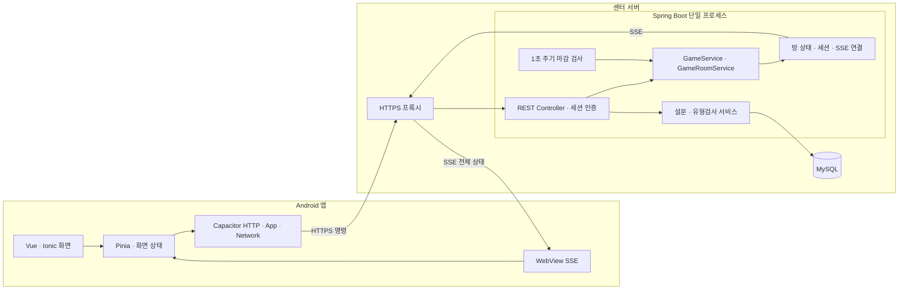
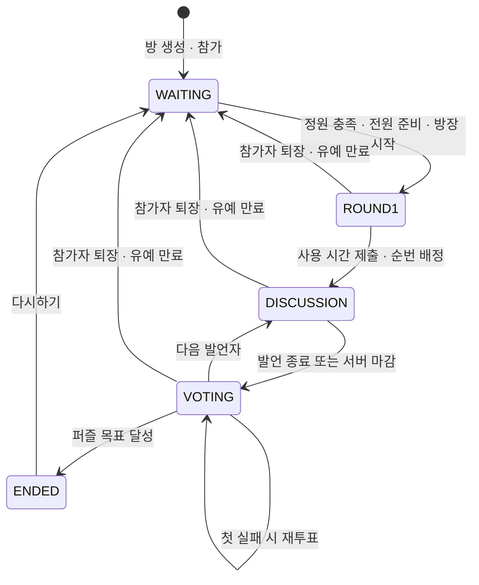

# 수햇 · Suhat

> 스마트폰 사용 습관을 돌아보고, 카드 이야기와 퍼즐 게임으로 함께 대화하는 모바일 서비스.

수햇은 이용습관 설문, 사용 유형 검사, 1인 게임과 3~4인 보드게임을 제공하는 Android 앱과 서버다. 여러 참가자가 같은 방에서 카드에 대한 이야기를 나누고 투표하며 퍼즐 조각을 모은다.

| 기능 | 설명 |
|---|---|
| 이용습관 설문 | 문항 응답과 점수 저장 |
| 사용 유형 검사 | 서비스 유형별 문항을 풀고 결과 설명·제안 확인 |
| 1인 게임 | 앱에 포함된 카드·매칭 데이터로 진행 |
| 다인 게임 | 방 생성·바코드 참가, 발언 순서, 카드 선택, 투표, 퍼즐·순위 |
| 모바일 복구 | 백그라운드·네트워크 단절 후 현재 게임 상태로 복귀 |

이 저장소는 **백엔드**다. 앱 소스는 [suhat-frontend](https://github.com/donghyeon0619/suhat-frontend)에 있다.

[전체 구조](#전체-아키텍처) · [게임과 재접속](#게임과-재접속) · [실행](#실행) · [API 명세](docs/api.md) · [개발 규칙](CONTRIBUTING.md)

## 기술 스택

| 영역 | 기술 | 역할 |
|---|---|---|
| 앱 UI | Vue 3 · TypeScript · Ionic Vue 8 | 반응형 화면과 모바일 UI |
| 앱 상태·라우팅 | Pinia 2 · Vue Router / Ionic Router | 사용자·게임 상태와 화면 이동 |
| 네이티브 | Capacitor 6 · Android | HTTP·쿠키·앱 상태·네트워크·바코드 플러그인 |
| 웹 빌드 | Vite 5 · Sass | 정적 자산 빌드 |
| 서버 | Java 17 · Spring Boot 3.3.4 | REST API·게임 규칙·스케줄러 |
| 인증 | Spring Security · Servlet 세션 | JSESSIONID 기반 요청 인증 |
| 데이터 | Spring Data JPA · Hibernate · MySQL | 사용자·설문·유형검사 저장 |
| 실시간 통신 | Spring SseEmitter · event-source-polyfill | 서버 → 앱 상태 전송 |
| 테스트 | JUnit 5 · Mockito · MockMvc · Vitest · Vue Test Utils | 게임 규칙·연결·화면 계약 검증 |
| 빌드·CI | Gradle · npm · GitHub Actions | 서버 테스트·앱 빌드·Capacitor 동기화 |

H2는 격리된 Android 연결 검증 서버에서만 사용한다. Redis·메시지 브로커·다중 게임 서버를 전제로 하지 않는다.

## 전체 아키텍처



센터의 서버에서 Spring Boot 프로세스 **하나**를 운영한다. 방 상태·세션·SSE 연결은 프로세스 메모리에 있고 사용자·설문·유형검사 데이터는 MySQL에 저장한다. HTTPS 프록시는 같은 서버 앞단에 둘 수 있으며 게임 상태를 갖지 않는다.

동시 요청과 스케줄러는 같은 방 객체의 잠금을 사용한다. 투표 제출과 마감 처리가 겹쳐도 같은 방의 집계를 직렬화하고, 서로 다른 방은 별도로 진행한다. 분산 잠금이나 서버 간 상태 복제는 이 운영 구조에 필요하지 않다.

서버 재시작은 진행 중인 게임이 끝난 뒤 수행한다. 프로세스를 재시작하면 메모리의 방·세션은 유지되지 않는다.

## 게임과 재접속



| 규칙 | 동작 |
|---|---|
| 연결 끊김 | 180초 재접속 유예. 연결 끊김 감지 시각 또는 마지막 heartbeat 기준 |
| 앱 백그라운드 | 전송 연결만 닫고 방 참가 상태 유지 |
| 복귀·네트워크 복구 | 현재 상태 전체를 받아 화면 복원 |
| 발언 시간 | 기본 180초. 발언자가 끊겨도 서버 시계는 계속 진행 |
| 시간 연장 | 현재 발언자가 한 번, 120초 연장 |
| 투표 시간 | 기본 30초. 미제출은 기권 |
| 퍼즐 획득 | 3인 동의 1표, 4인 동의 2표. 첫 실패 시 한 번 재투표 |
| 유예 만료·명시적 퇴장 | 게임 종료 후 남은 참가자는 대기방 이동 |

SSE `game-state`의 `id`와 본문 `revision`은 동일한 방 버전이다. 이전 버전·이전 연결의 응답은 무시하고 새 snapshot으로 카드·발언자·시간·투표 상태를 복원한다. 놓친 이벤트의 애니메이션은 다시 재생하지 않는다.

## 서버 책임과 디렉터리

```text
src/main/java/com/coders/boardgame/
├── config/                 # 인증 · CORS · 쿠키 설정
├── filter/                 # 세션 인증 필터
├── exception/              # 오류 응답
└── domain/
    ├── user/               # 사용자 등록 · 세션
    ├── habitsurvey/        # 이용습관 설문 · 결과
    ├── typetest/           # 유형검사 문항 · 유형 판정
    └── game/
        ├── controller/    # 방 · 게임 명령 · SSE API
        ├── domain/        # GameProgress · GameTiming
        ├── dto/           # 방 · 참가자 · snapshot
        ├── service/       # 상태 전이 · 방 수명 · 연결 전송
        ├── event/         # 연결 종료 · 게임 종료 이벤트
        └── component/     # 유예·마감 검사
src/test/                   # 회귀 테스트 · 격리 서버 설정
docs/                       # API · 재접속 계약 · 모바일 검증 서버
```

| 구성 요소 | 책임 |
|---|---|
| `GameProgress` | 투표·마감 시각·최근 결과·상태 버전 |
| `GameTiming` | 재접속·발언·투표 시간 설정 |
| `GameService` | 권한 검사, 게임 단계 전환, 투표 집계 |
| `GameRoomService` | 참가·퇴장, 재접속 유예, 방 상태 발행 |
| `GameSseService` | 연결 교체·종료와 이벤트 전송 |
| `GameStateMapper` | 잠금 안에서 현재 방 상태를 응답으로 복사 |
| `GhostPlayerCleaner` | 1초마다 유예 만료와 게임 마감 처리 |

도메인별로 컨트롤러·서비스·DTO·저장소를 나눈 구조다. 게임 진행 상태는 DB 엔티티가 아니라 방 메모리에서 관리한다. 설문과 유형검사의 문항·선택지·결과는 JPA 저장소를 사용한다.

## 실행

### 게임 연결만 검증하는 서버

Java 17을 준비한 뒤 실행한다. 운영 DB가 필요 없다.

```sh
./gradlew mobileSmokeServer --no-daemon
```

Windows에서는 `./gradlew.bat`을 사용한다. 서버는 `127.0.0.1:18080`에서 H2 메모리 DB로 실행된다. **운영 application.yml을 읽지 않는다.** HTTPS 터널 연결과 앱 실행은 [Android 검증 서버](docs/mobile-smoke-server.md)를 따른다. 종료하면 테스트 데이터가 사라진다.

### 전체 서비스 실행

Java 17과 별도 MySQL을 준비하고, 운영 자격증명이 없는 외부 설정 파일을 사용한다.

```sh
./gradlew bootJar
java -jar build/libs/boardgame-0.0.1-SNAPSHOT.jar --spring.config.location=file:/path/to/application-center.properties
```

JAR 파일명은 실제 `build/libs` 산출물에 맞춘다. 최소 설정 항목:

| 설정 | 용도 |
|---|---|
| `spring.datasource.url`, `username`, `password` | 센터 MySQL 연결 |
| `spring.datasource.driver-class-name` | MySQL 드라이버 |
| `spring.jpa.hibernate.ddl-auto` | 환경에 맞는 스키마 정책 |
| `frontend.url` | 허용할 앱/API HTTPS origin |
| `server.servlet.session.cookie.domain` | API 호스트의 쿠키 도메인 |
| `server.servlet.session.cookie.secure` | HTTPS 쿠키 사용 |
| `server.servlet.session.cookie.same-site` | 모바일 쿠키 정책 |
| `server.ssl.*` 또는 HTTPS 프록시 | TLS 설정 |
| `server.forward-headers-strategy` | 신뢰할 수 있는 TLS 프록시 뒤에서 `framework` |
| `game.reconnect-seconds` | 기본 180 |
| `game.speaking-seconds` | 기본 180 |
| `game.voting-seconds` | 기본 30 |

설문·유형검사에는 기준 문항과 결과 유형 데이터가 필요하다. H2 연결 검증 서버만으로 이 데이터를 대신하지 않는다. HTTPS 프록시는 SSE 응답 버퍼링을 끄고 유휴 제한을 heartbeat 간격인 30초보다 길게 설정한다.

## API 빠른 탐색

| 영역 | 경로 | 상세 |
|---|---|---|
| 사용자·세션 | `/api/users`, `/api/users/session` | 등록·세션 확인 |
| 이용습관 | `/api/surveys`, `/api/surveys/results` | 문항 조회·결과 저장 |
| 유형검사 | `/api/test-questions/service-type/{id}`, `/api/test-results` | 문항·유형 판정 |
| 방 | `/api/rooms/**` | 생성·참가·조회·퇴장·heartbeat |
| 게임 명령 | `/api/games/{roomId}/**` | 시작·카드·발언·투표·다시하기 |
| 실시간 상태 | `/api/sse/rooms/connect/{roomId}` | 세션 인증 SSE |

전체 **23개 엔드포인트**, 요청·응답 예시, 상태 필드와 오류 규칙은 [API 명세](docs/api.md)에 정리했다. 신규 게임 화면은 `game-state` 전체 상태 계약을 기준으로 구현한다.

## 검증

```sh
./gradlew test --tests '*GameRecoveryTest' --tests '*GameConnectionTest' --tests '*CookieConfigTest'
```

서버 테스트 15개로 재접속 유예, 권한, 중복·지연 투표, 동시 마감 처리, 기권, SSE 응답과 쿠키 도메인을 확인했다. 외부 DB 설정을 읽는 기존 `contextLoads`는 이 명령에서 제외한다.

Android 14 에뮬레이터와 임시 HTTPS 주소에서는 APK 실행, 네이티브 세션, SSE, 백그라운드 복귀, 네트워크 단절·복구, 서버 마감과 유예 만료를 확인했다. 물리적 휴대폰·iOS·운영 MySQL 전체 통합 검증은 별도다.

## 협업

`feat/설명`, `fix/설명` 브랜치와 기존 `[feat]:`, `[fix]:`, `[test]:`, `[docs]:` 커밋 형식을 따른다. Java는 4칸 들여쓰기와 생성자 주입을 사용한다. 상태·API 계약을 바꿀 때 앱 변경과 회귀 테스트를 함께 검토한다. 자세한 기준은 [CONTRIBUTING](CONTRIBUTING.md)을 참고한다.

## 관련 문서

- [API 명세](docs/api.md)
- [게임 재접속과 서버 타이머](docs/game-reconnection.md)
- [Android 연결 검증 서버](docs/mobile-smoke-server.md)
- [프론트엔드 저장소](https://github.com/donghyeon0619/suhat-frontend)
